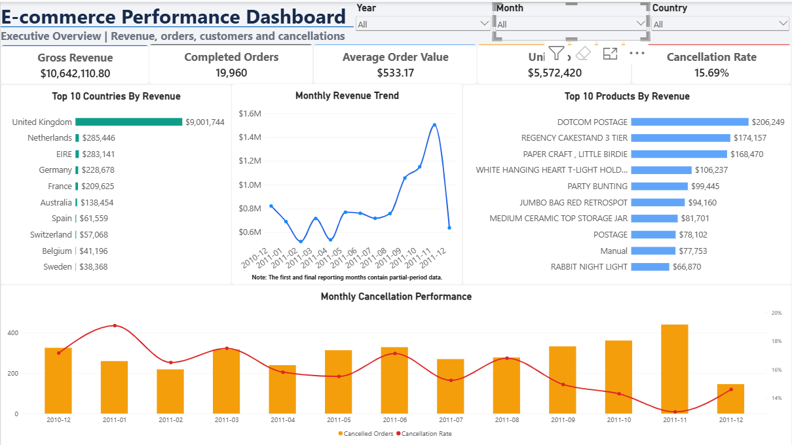
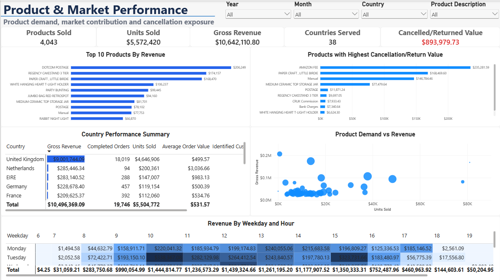
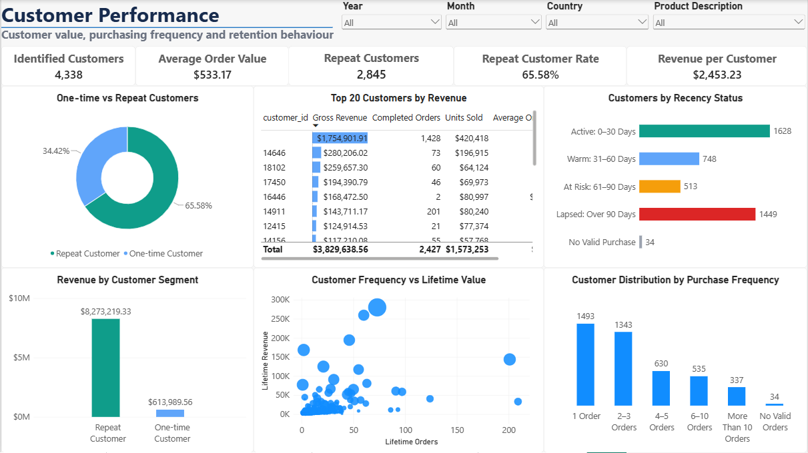
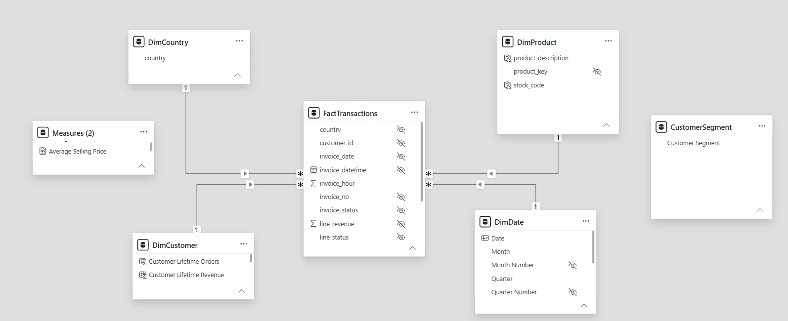

# E-commerce Performance Dashboard

An end-to-end business intelligence project analysing e-commerce revenue, orders, product demand, market performance, customer behaviour, and cancellation exposure. The project uses Power Query for data preparation, PostgreSQL and SQL for validation and analysis, and Power BI for data modelling and interactive reporting.

## Dashboard Preview

### Executive Overview



### Product and Market Performance



### Customer Performance



## Business Objective

The dashboard was designed to help e-commerce, sales, marketing, and product managers answer the following questions:

- How are revenue and orders changing over time?
- Which products and markets generate the most revenue?
- What are the average order value and units sold?
- How significant is cancellation and return exposure?
- What proportion of identified customers purchase repeatedly?
- Which customers generate the greatest value?
- Which customer groups should be retained or re-engaged?
- When do the strongest purchasing periods occur?

## Key Results

| KPI | Result |
|---|---:|
| Transaction lines | 535,187 |
| Reporting period | 1 Dec 2010–9 Dec 2011 |
| Unique invoices | 24,446 |
| Identified customers | 4,338 |
| Gross revenue | £10,642,110.80 |
| Estimated net revenue | £9,748,131.07 |
| Completed orders | 19,960 |
| Units sold | 5,572,420 |
| Average order value | £533.17 |
| Cancellation rate | 15.69% |
| Cancelled/returned value | £893,979.73 |
| Repeat customers | 2,845 |
| Repeat-customer rate | 65.58% |

## Principal Findings

- **November 2011** was the strongest revenue month, generating **£1,503,866.78**.
- The **United Kingdom** generated **£9,001,744.09**, approximately **84.59%** of gross revenue, indicating substantial geographic concentration.
- **DOTCOM POSTAGE** was the highest-revenue product at **£206,248.77**. Postage-related revenue should be separated from merchandise performance when evaluating inventory demand.
- **2,845 of 4,338 identified customers** made repeat purchases, producing a **65.58% repeat-customer rate**.
- Customer **14646** was the highest-value customer, generating **£280,206.02**.
- The **15.69% cancellation rate** and **£893,979.73 cancelled/returned value** represent meaningful commercial exposure requiring product- and market-level monitoring.

See the complete [analysis summary](documentation/analysis-summary.md) for recommendations, assumptions, and limitations.

## Dashboard Pages

### 1. Executive Overview

Provides headline revenue, order, unit, average-order-value, and cancellation KPIs together with monthly trends and leading products and markets.

### 2. Product and Market Performance

Examines product demand versus value, leading countries, purchasing patterns by weekday and hour, and products with the greatest cancellation or return exposure.

### 3. Customer Performance

Compares one-time and repeat customers, highlights high-value customers, and analyses purchase frequency and recency-based customer groups.

## Data Model

The Power BI semantic model follows a star-schema design, with `FactTransactions` connected to date, product, customer, and country dimensions through one-to-many relationships.



Core model tables:

- `FactTransactions` — one row per retained invoice line
- `DimDate` — calendar attributes and chronological sorting fields
- `DimProduct` — product keys, stock codes, and descriptions
- `DimCustomer` — customer identifiers and lifetime customer attributes
- `DimCountry` — country-level filtering
- `Measures` — reusable DAX business measures

## Data Preparation

The preparation workflow included:

1. Importing and profiling the original Excel workbook in Power Query.
2. Standardising column names and data types.
3. Trimming and cleaning text fields.
4. Removing blank product descriptions and exact duplicate records.
5. Retaining anonymous transactions for sales analysis while excluding them from customer-level KPIs.
6. Classifying valid sales, cancellations/returns, zero-quantity records, and invalid-price records.
7. Calculating line revenue and date attributes.
8. Loading the cleaned transactions into PostgreSQL.
9. Validating row counts, calculated fields, dates, classifications, and KPI results with SQL.
10. Building and validating the Power BI star schema and DAX measures.

## SQL Analysis

The SQL workflow is organised into four scripts:

- [`01_data_validation.sql`](sql/01_data_validation.sql) — row counts, missing values, key uniqueness, revenue validation, and date validation
- [`02_sales_analysis.sql`](sql/02_sales_analysis.sql) — executive KPIs, monthly trends, products, countries, purchasing times, and UK revenue contribution
- [`03_customer_analysis.sql`](sql/03_customer_analysis.sql) — purchase frequency, repeat customers, customer value, and RFM metrics
- [`04_principal_findings.sql`](sql/04_principal_findings.sql) — consolidated portfolio findings for cross-checking Power BI

## Tools and Skills Demonstrated

- **Power Query:** cleaning, transformation, profiling, calculated columns, and repeatable ETL
- **PostgreSQL:** relational storage and schema management
- **SQL:** CTEs, conditional aggregation, window functions, validation queries, time-series analysis, and customer analysis
- **Power BI:** star-schema modelling, DAX measures, interactive filtering, drill-through context, report-page tooltips, bookmarks, and dashboard design
- **Excel:** initial dataset handling and Power Query hosting
- **Git and GitHub:** version control and portfolio documentation

## Repository Structure

```text
ecommerce-performance-dashboard/
├── data/
│   ├── raw/                         # Excluded from Git
│   └── processed/                   # Excluded from Git
├── documentation/
│   ├── analysis-summary.md
│   ├── findings_202610282109.csv
│   └── project-scope.md
├── images/
│   ├── customer-performance.png
│   ├── data-model.png
│   ├── executive-overview.png
│   └── product-market-performance.png
├── powerbi/
│   └── ecommerce_performance_dashboard.pbix
├── sql/
│   ├── 01_data_validation.sql
│   ├── 02_sales_analysis.sql
│   ├── 03_customer_analysis.sql
│   └── 04_principal_findings.sql
├── .gitignore
└── README.md
```

## How to Use the Project

1. Download the dataset from the [UCI Online Retail dataset page](https://archive.ics.uci.edu/dataset/352/online%2Bretail).
2. Place `Online Retail.xlsx` in `data/raw/`.
3. Use the Power Query workflow in `ecommerce_data_cleaning.xlsx` locally to prepare the data, or reproduce the documented transformations.
4. Create a PostgreSQL database and load the cleaned transaction file into an `ecommerce.transactions` table.
5. Run the SQL scripts in numerical order.
6. Open `powerbi/ecommerce_performance_dashboard.pbix` and update the PostgreSQL credentials or data-source settings for your environment.
7. Refresh the Power BI model and compare the headline KPIs with `documentation/findings_202610282109.csv`.

The raw and processed datasets are intentionally excluded from Git because of their size. The Power BI file, SQL scripts, documentation, and dashboard images remain included.

## Limitations

- The dataset covers a limited historical reporting period.
- December 2010 and December 2011 are incomplete reporting months.
- Some transactions do not contain customer identifiers.
- Product cost and profit information are unavailable.
- Marketing expenditure, acquisition channels, website sessions, and shopping-cart activity are unavailable.
- Conversion rate, customer-acquisition cost, advertising return, and cart-abandonment rate cannot be calculated reliably.
- Cancellation and return reason codes are not provided.

## Data Source and Attribution

The project uses the **Online Retail** dataset from the UCI Machine Learning Repository. It contains transactions recorded between 1 December 2010 and 9 December 2011 for a UK-based non-store retailer, and unit prices are recorded in sterling.

> Chen, D. (2015). *Online Retail* [Dataset]. UCI Machine Learning Repository. https://doi.org/10.24432/C5BW33

The dataset is distributed under the [Creative Commons Attribution 4.0 International licence](https://creativecommons.org/licenses/by/4.0/).
